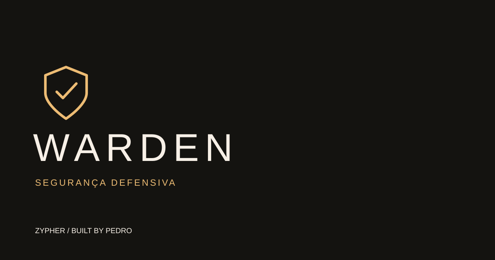

# WARDEN



**SEGURANÇA DEFENSIVA** · protótipo em desenvolvimento no ecossistema Zypher.

[Abrir interface](https://website-kohl-six-11.vercel.app/labs/warden/) · [Escopo e limites](docs/DELIVERY-2026-10-28.md)

Verifique a integridade de arquivos por SHA-256, sem upload. Crie uma referência, exporte em JSON e compare depois. A verificação é real e local; não é um antivírus nem um EDR.

## Executar

```sh
python -m http.server 8000
```

Abra http://localhost:8000/preview/. Nenhuma dependência npm necessária.

Nome oficial: **WARDEN**. O endereço legado `Aegis` é mantido até a renomeação administrativa do repositório.
